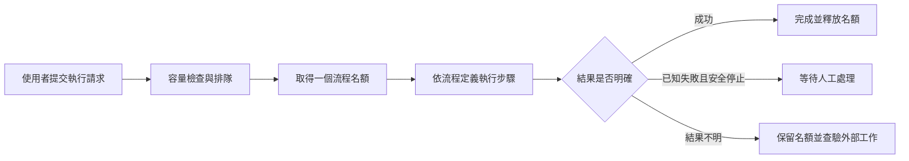

# Route Engine 使用者指南

適用版本：2026 年 9 月 26 日完成工程驗收的 Route Engine v1。文件核對日期：2026 年 9 月 27 日。

這份指南寫給第一次接觸系統的人。你不需要先懂 Java；若要在自己的電腦啟動練習環境，則需要能使用終端機與 Docker。完整動手練習請從第 4 節開始，在同一個 Bash 視窗依序完成第 5 節與第 8.2 節的清理。若管理員已提供團隊服務，可先閱讀第 1～3 節及第 6～9 節的概念與維運說明；實際套用時請向管理員取得該環境的操作程序，不要把本機練習的建立、接單設定或清理指令套到團隊服務。

目前工程規格已完成，正式環境的端點、企業原有五條流程與憑證尚未驗證。詳細完成度及證據見 [實作進度](實作進度.md)。

## 目錄

1. 這套系統能做什麼
2. 先認識幾個名詞
3. 帳號權限與操作方式
4. 在 Windows 建立本機練習環境
5. 建立、發布並執行第一條流程
6. 看懂執行狀態與排隊規則
7. 修改流程與人工處理失敗
8. 排錯、停止與清理
9. 從練習走向真實整合

## 1. 這套系統能做什麼

Route Engine 負責依照你定義的步驟執行一條流程。例如：「先呼叫內部 API → 條件成立時並行執行兩項檢查 → 執行 Ansible → 等 Kubernetes 工作完成」。它會把進度保存在 MariaDB，程式重新啟動後可以依保存的狀態繼續處理。

它同時管理工作容量、排隊順序、有限次數的重試，以及需要人工判斷的失敗。當外部工作結果不明時，系統會保留紀錄與容量，等待查明結果，避免直接再做一次可能產生重複效果的操作。

目前以 **HTTP API** 操作，提供 JSON 格式的流程定義與 OpenAPI 文件。**沒有供一般使用者點選的網頁介面，也沒有拖拉式流程編輯器。** 你可以使用本指南的 `curl`，或使用組織允許的 API 工具。

支援的流程組合包括依序執行、受限條件判斷、一層平行分支、REST、Kubernetes Job／Deployment、Ansible，以及明確宣告的單一步驟補償。它不支援任意程式碼、無限迴圈或任意深度的平行流程。



## 2. 先認識幾個名詞

| 名詞 | 白話意思 | 例子 |
|---|---|---|
| Route（流程） | 一項工作流程的名稱與識別碼 | `demo-engine` |
| Version（版本） | 某一次發布的完整流程定義 | 第 1 版、第 2 版 |
| Execution（執行） | 實際跑一次流程的紀錄 | 同一流程今天執行兩次，會有兩個 ID |
| Step／Node（步驟／節點） | 流程內的一個動作或結構 | REST 呼叫、條件、平行分支 |
| Permit（執行名額） | 整條 execution 使用的容量配額 | 一條有三個平行分支的流程仍只占一個名額 |
| Adapter（介接器） | 與外部系統溝通的實作 | REST、Kubernetes、Ansible |
| Catalog ref（設定參照） | 管理員預先設定好的外部目標名稱 | `endpointRef`，而非使用者任填 URL |
| Incident（待處理事件） | 系統記錄、需要判斷的特定問題 | 某一步驟失敗或外部結果不明 |
| Idempotency-Key（冪等鍵） | 辨識「這是同一次請求」的自訂代碼 | `training-001` |

請分清楚三種數字：`version` 是流程定義版本；`stateVersion` 是更新時防止覆蓋別人修改的版本；`configVersion` 是容量設定版本。修改前先讀取最新值，不要把這三者互換。

## 3. 帳號權限與操作方式

管理員會提供服務網址與 Bearer token。Token 等同操作憑證，不要放進流程 JSON、請求識別碼、截圖、問題回報或 Git。系統沒有預設密碼，也不提供使用者自行註冊介面。

| 角色 | 可以做什麼 |
|---|---|
| caller | 讀取流程與容量、提交執行、查詢自己的 execution 與原始接單決策 |
| operator | caller 的能力，加上查詢營運狀態、處理 incident、恢復／取消、讀取 metrics |
| admin | operator 的能力，加上建立與修改流程、發布版本、調整容量 |

目前每個角色對應一個固定身分；不是完整的多人帳號／IAM 系統。接單決策的查詢仍限定原提交身分，admin 不會因此自動看到另一個身分的決策。

以下本機教學使用隨機產生的暫時 admin token，讓你可以完成整個練習。團隊使用時應由管理員依職責分配角色。

## 4. 在 Windows 建立本機練習環境

### 4.1 準備與範圍

需要 Windows、已啟用的 WSL2 Ubuntu、Docker Desktop Linux containers，且 Ubuntu 的 Docker 整合可用。專案使用 Java 21 與 Maven Wrapper；工具版本由 repository 固定。本機 API 入門練習不需要 Kubernetes，實際 Ansible／Kubernetes 整合才需要另外準備。

本次核對的環境為 WSL2、Java 21.0.12.1、Maven 3.9.11、Docker 29.4.0。這是已驗證的環境紀錄，並非宣稱只能使用這些作業系統 patch。

先在 **PowerShell** 開啟此專案的 Ubuntu shell。若你把專案放在其他位置，請更換路徑：

```powershell
wsl.exe -d Ubuntu --cd /mnt/c/Users/Nier/.codex/worktrees/d831/simple-route-engine
```

下列命令全部在**同一個 Ubuntu Bash 視窗、專案根目錄**依序執行，不能直接貼到 PowerShell。每一段完成後再進入下一段。本教學會建立專屬測試 DB 與本機 Java 程序；只使用新產生的練習資料。

> 第一條流程使用 `dev.success` 開發介接器，讓你專注學會 API 與版本管理。MariaDB、HTTP API 與引擎都是真實執行，但這個節點不會呼叫真實企業 REST 服務；也不代表已執行 Kubernetes／Ansible。真實 adapter 的驗收範圍另見完成度報告。

### 4.2 載入工具並建置

<!-- walkthrough: setup -->
```bash
set -euo pipefail
export ROUTE_RUN_ID="guide-$(date -u +%Y%m%dT%H%M%SZ)-$RANDOM"
export PYTHONDONTWRITEBYTECODE=1
if [[ ! -x .tools/java/bin/java || ! -x .tools/maven/bin/mvn ]]; then
  bash scripts/bootstrap-tools.sh
fi
source scripts/env.sh
docker info --format '{{.OSType}} {{.ServerVersion}}'
java -version
bash mvnw -DskipTests package
```

Docker 應顯示 `linux`，建置最後應顯示 `BUILD SUCCESS`。`-DskipTests` 是為了入門練習先產生 JAR；**這個命令不等於執行完整驗收測試**。若 bootstrap 需要下載但網路不通，先處理錯誤，不要繼續往下。

### 4.3 建立隔離資料庫與暫時憑證

以下會產生唯一名稱與隨機密碼；不必手動填任何正式憑證。練習檔案放在 Git 已忽略的 `.local/`。

<!-- walkthrough: database -->
```bash
umask 077
export DEMO_HOME="$PWD/.local/$ROUTE_RUN_ID"
mkdir -p "$DEMO_HOME"
DB_CONTAINER="re-$ROUTE_RUN_ID-db"
ROOT_PASSWORD="$(openssl rand -hex 32)"
export ROUTE_DB_USER=route_user
export ROUTE_DB_PASSWORD="$(openssl rand -hex 32)"
export ROUTE_TOKEN="$(openssl rand -hex 32)"
export ROUTE_ADMIN_TOKEN_SHA256="$(printf '%s' "$ROUTE_TOKEN" | sha256sum | cut -d' ' -f1)"
unset ROUTE_CALLER_TOKEN_SHA256 ROUTE_OPERATOR_TOKEN_SHA256 ROUTE_ADAPTERS_CONFIG
printf 'MARIADB_ROOT_PASSWORD=%s\nMARIADB_DATABASE=route_demo\nMARIADB_USER=%s\nMARIADB_PASSWORD=%s\n' \
  "$ROOT_PASSWORD" "$ROUTE_DB_USER" "$ROUTE_DB_PASSWORD" > "$DEMO_HOME/database.env"
unset ROOT_PASSWORD
APP_PID=''
cleanup_demo() {
  if [[ -n "$APP_PID" ]] && kill -0 "$APP_PID" 2>/dev/null; then
    kill -TERM "$APP_PID"
    wait "$APP_PID" || true
  fi
  local owner
  owner="$(docker inspect -f '{{ index .Config.Labels "route-engine.tutorial" }}' "$DB_CONTAINER" 2>/dev/null || true)"
  if [[ "$owner" == "$ROUTE_RUN_ID" ]]; then
    docker rm -f -v "$DB_CONTAINER" >/dev/null
  fi
}
trap cleanup_demo EXIT
docker run --detach --name "$DB_CONTAINER" \
  --label "route-engine.tutorial=$ROUTE_RUN_ID" \
  --publish 127.0.0.1::3306 --env-file "$DEMO_HOME/database.env" \
  "$(cat config/mariadb-image.txt)" >/dev/null
DB_READY=false
for i in {1..60}; do
  if docker exec "$DB_CONTAINER" healthcheck.sh --connect --innodb_initialized >/dev/null 2>&1; then
    DB_READY=true; break
  fi
  sleep 2
done
[[ "$DB_READY" == true ]] || { echo '資料庫啟動失敗'; exit 1; }
DB_PORT="$(docker port "$DB_CONTAINER" 3306/tcp | sed 's/.*://')"
export ROUTE_DB_URL="jdbc:mariadb://127.0.0.1:$DB_PORT/route_demo"
```

資料庫只發布到 loopback，Docker 分配實際可用 port。清理函式會先比對容器的本次練習標籤，才移除它與其匿名 volume，不會清掉整個 Docker 環境。這份練習 DB 不保留長期資料。

### 4.4 啟動引擎

<!-- walkthrough: start -->
```bash
export SPRING_PROFILES_ACTIVE=engine-development
export ROUTE_ENGINE_FIXTURE_DIRECTORY="$DEMO_HOME/fixtures"
export ROUTE_LOG_FILE="$DEMO_HOME/route-engine.log"
export ROUTE_PORT="$(python3 -B -c 'import socket; s=socket.socket(); s.bind(("127.0.0.1",0)); print(s.getsockname()[1]); s.close()')"
export BASE="http://127.0.0.1:$ROUTE_PORT"
bash scripts/local-run.sh > "$DEMO_HOME/application.log" 2>&1 &
APP_PID=$!
APP_READY=false
for i in {1..60}; do
  kill -0 "$APP_PID" 2>/dev/null || break
  if curl --silent --fail "$BASE/actuator/health/readiness" > "$DEMO_HOME/readiness.json"; then
    APP_READY=true; break
  fi
  sleep 2
done
[[ "$APP_READY" == true ]] || { echo "引擎啟動失敗，查看 $DEMO_HOME/application.log"; exit 1; }
printf '本次練習 API：%s\n' "$BASE"
python3 -m json.tool "$DEMO_HOME/readiness.json"
```

Readiness 應回傳 `UP`。Port 每次可能不同，以畫面印出的 `BASE` 為準。若 port 剛好被其他程序搶走，這段會失敗；查看 log 後重新開始新的練習，不要把別人的服務當成本次引擎。

`engine-development` 只適用本機教學。真正介接外部服務時需使用管理員設定的 catalog，不能把這個開發 profile 帶進正式環境。

## 5. 建立、發布並執行第一條流程

本節必須接續完整的第 4 節，在同一個 Bash 視窗與專案根目錄執行。前面已準備 `ROUTE_RUN_ID`、`DEMO_HOME`、`BASE`、`ROUTE_TOKEN`、開發 profile、清理函式，以及 repository 內的 `examples/demo-engine.json`；請不要略過這些前置步驟。此教學使用全新的專屬 DB、admin 權限，且 `demo-engine` 尚不存在。若要操作管理員提供的既有服務，請依該環境的 route、catalog 與權限設定另行準備，不要直接照貼本節。

### 5.1 讀取並啟用容量設定

教學使用你剛建立的 DB。先查設定，再保留其數值與最新 `configVersion`，只打開接單。不要拿這段替別人的服務擅自恢復接單。

<!-- walkthrough: capacity -->
```bash
api() { curl --silent --show-error --fail-with-body -H "Authorization: Bearer $ROUTE_TOKEN" "$@"; }
api "$BASE/capacity" > "$DEMO_HOME/capacity.json"
python3 -B - <<'PY'
import json, os
from pathlib import Path
p=Path(os.environ['DEMO_HOME'])
c=json.loads((p/'capacity.json').read_text())
keys=['totalSlots','criticalReserved','highWeight','normalWeight','lowWeight','configVersion']
body={k:c[k] for k in keys}
body.update(admissionEnabled=True, reason='本機入門教學：啟用接單')
(p/'enable-admission.json').write_text(json.dumps(body,ensure_ascii=False))
PY
api -X PUT -H 'Content-Type: application/json' --data-binary @"$DEMO_HOME/enable-admission.json" \
  "$BASE/capacity/config" > "$DEMO_HOME/capacity-enabled.json"
python3 -m json.tool "$DEMO_HOME/capacity-enabled.json"
```

應看到 `admissionEnabled: true`。預設總容量 100、CRITICAL 保留 20，其他優先級的放行權重為 HIGH:NORMAL:LOW = 6:3:1。

### 5.2 建立流程、建立草稿、發布

先建立流程的基本資料，再送出版本定義，最後才發布。草稿可以改；發布後的版本不可修改。

<!-- walkthrough: publish -->
```bash
api -X POST -H 'Content-Type: application/json' \
  --data '{"routeId":"demo-engine","name":"DEMO 我的第一條流程"}' \
  "$BASE/routes" > "$DEMO_HOME/route.json"
api -X POST -H 'Content-Type: application/json' --data-binary @examples/demo-engine.json \
  "$BASE/routes/demo-engine/versions" > "$DEMO_HOME/draft.json"
python3 -B - <<'PY'
import json, os
from pathlib import Path
p=Path(os.environ['DEMO_HOME']); v=json.loads((p/'draft.json').read_text())
assert v['version']==1 and v['status']=='DRAFT'
(p/'publish.json').write_text(json.dumps({'stateVersion':v['stateVersion']}))
PY
api -X POST -H 'Content-Type: application/json' --data-binary @"$DEMO_HOME/publish.json" \
  "$BASE/routes/demo-engine/versions/1/publish" > "$DEMO_HOME/published.json"
python3 -m json.tool "$DEMO_HOME/published.json"
```

建立流程與草稿的 HTTP 狀態碼是 `201`，發布成功是 `200`；最後應看到 `status: PUBLISHED`。`examples/demo-engine.json` 已包好 API 所需的 `definition` 欄位，不能把只有內層 definition 的 JSON 當成相同請求送出。

這條範例先執行 `prepare`，得到 `ready: true`，再選擇條件成立的 `yes` 分支。每次判斷與結果會保存在 DB。

### 5.3 送出一次執行並等待完成

<!-- walkthrough: execute -->
```bash
REQUEST_KEY="training-$ROUTE_RUN_ID-001"
printf '%s\n' '{"routeId":"demo-engine","routeVersion":1,"priority":"NORMAL","admissionMode":"QUEUE","input":{}}' \
  > "$DEMO_HOME/execute.json"
api -X POST -H 'Content-Type: application/json' -H "Idempotency-Key: $REQUEST_KEY" \
  --data-binary @"$DEMO_HOME/execute.json" "$BASE/executions" > "$DEMO_HOME/submission.json"
EXECUTION_ID="$(python3 -B -c 'import json,sys; print(json.load(open(sys.argv[1]))["executionId"])' "$DEMO_HOME/submission.json")"
for i in {1..60}; do
  api "$BASE/executions/$EXECUTION_ID" > "$DEMO_HOME/execution.json"
  STATE="$(python3 -B -c 'import json,sys; print(json.load(open(sys.argv[1]))["state"])' "$DEMO_HOME/execution.json")"
  case "$STATE" in SUCCEEDED|FAILED|CANCELLED|MANUAL_WAIT) break ;; esac
  sleep 1
done
python3 -m json.tool "$DEMO_HOME/execution.json"
python3 -B - "$DEMO_HOME/execution.json" <<'PY'
import json,sys
d=json.load(open(sys.argv[1]))
assert d['state']=='SUCCEEDED' and d['permitHeld'] is False, '尚未成功完成，請依第 8 節查看狀態'
print('第一條流程已成功，執行名額已釋放。')
PY
```

提交成功是 HTTP `202`，代表接單或排隊，**不是流程已完成**。真正完成要看 `GET /executions/{id}` 的 `state: SUCCEEDED` 與 `permitHeld: false`。

### 5.4 練習「重送同一次請求」

網路斷線時，你可能不知道伺服器是否已接單。此時保留相同 key 與相同內容重送，不能直接換 key 再送一遍。

<!-- walkthrough: replay -->
```bash
api -X POST -H 'Content-Type: application/json' -H "Idempotency-Key: $REQUEST_KEY" \
  --data-binary @"$DEMO_HOME/execute.json" "$BASE/executions" > "$DEMO_HOME/replay.json"
api "$BASE/admission-requests?key=$REQUEST_KEY" > "$DEMO_HOME/decision.json"
python3 -B - <<'PY'
import json,os
from pathlib import Path
p=Path(os.environ['DEMO_HOME'])
a=json.loads((p/'submission.json').read_text()); b=json.loads((p/'replay.json').read_text())
assert a==b
print('重送得到原始決策，沒有新增第二個 execution：'+b['executionId'])
PY
```

查到的 admission 決策可能仍是當初的 `QUEUED`，即使 execution 已經成功。這是刻意保留的原始接單結果；查進度請使用 execution API。

### 5.5 練習發布第 2 版

這次只新增一個完成步驟。既有第 1 版與舊 execution 不會被修改。

<!-- walkthrough: version -->
```bash
python3 -B - <<'PY'
import json,os
from pathlib import Path
p=Path(os.environ['DEMO_HOME']); body=json.loads(Path('examples/demo-engine.json').read_text())
body['definition']['version']=2
body['definition']['root']['children'].append({'id':'finish','type':'REST','endpointRef':'dev.success'})
(p/'version-2.json').write_text(json.dumps(body))
PY
api -X POST -H 'Content-Type: application/json' --data-binary @"$DEMO_HOME/version-2.json" \
  "$BASE/routes/demo-engine/versions" > "$DEMO_HOME/draft-2.json"
python3 -B - <<'PY'
import json,os
from pathlib import Path
p=Path(os.environ['DEMO_HOME']); d=json.loads((p/'draft-2.json').read_text())
(p/'publish-2.json').write_text(json.dumps({'stateVersion':d['stateVersion']}))
PY
api -X POST -H 'Content-Type: application/json' --data-binary @"$DEMO_HOME/publish-2.json" \
  "$BASE/routes/demo-engine/versions/2/publish" > "$DEMO_HOME/published-2.json"
api "$BASE/executions/$EXECUTION_ID" > "$DEMO_HOME/old-execution.json"
python3 -B - <<'PY'
import json,os
from pathlib import Path
p=Path(os.environ['DEMO_HOME'])
assert json.loads((p/'published-2.json').read_text())['status']=='PUBLISHED'
assert json.loads((p/'old-execution.json').read_text())['routeVersion']==1
print('第 2 版已發布；原 execution 仍綁定第 1 版。')
PY
```

新請求若省略 `routeVersion`，會在接單當下選定最新已發布版本；排隊途中再發布第 3 版，也不會讓已接單的 execution 偷換版本。明確指定 `routeVersion: 1` 則仍選第 1 版。

## 6. 看懂執行狀態與排隊規則

### 6.1 QUEUE 與 NOW_OR_REJECT 怎麼選

| 模式 | 適合的情境 | 沒有可用名額時 |
|---|---|---|
| `QUEUE` | 這件工作可以等 | 保存請求，等待依規則放行 |
| `NOW_OR_REJECT` | 現在拿不到名額就不做 | 回 `409 ADMISSION_REJECTED`，不留下之後偷偷啟動的工作 |

NOW 只承諾在接單交易中取得名額，不承諾外部工作立刻開始，也不會繞過既有排序。`GET /capacity` 是觀察快照，不是預約名額。

CRITICAL 有最高放行優先權，可使用保留容量及一般容量，但不會搶走已執行工作的名額。其他優先級同類內先到先處理，預設依 6:3:1 分配放行次數；這不是 CPU 比例，也不是完成時間保證。持續大量 CRITICAL 可能讓其他優先級等待很久。

### 6.2 常見狀態

| 狀態 | 你可以如何理解 |
|---|---|
| `QUEUED` | 等待名額，尚未占用 permit |
| `ADMITTED`／`RUNNING` | 已取得名額，等待或正在執行步驟 |
| `WAITING_EXTERNAL` | 外部工作尚未完成，名額仍保留 |
| `RETRY_WAIT` | 等待下一次允許的重試，名額仍保留 |
| `PAUSING`／`RECONCILING`／`CANCELING` | 正在收斂或確認外部工作，不能當成已停止 |
| `MANUAL_WAIT` | 已達可安全停止的人工處理點，名額已釋放 |
| `RECOVERY_QUEUED` | 人工恢復請求已排隊，尚未重新取得名額 |
| `RECOVERING`／`ROLLING_BACK` | 正在恢復或補償，持有新一代 permit |
| `SUCCEEDED`／`FAILED`／`CANCELLED` | 終態；所有已開始工作收斂後釋放名額 |

`IN_DOUBT` 描述某個外部 operation 結果未知，不是「可以放心重跑」。execution 可能呈現 `RECONCILING`，需從 incident 查原因。HTTP timeout、worker lease 到期或刪除 Job 的請求成功，都不等於外部工作真的停止。

## 7. 修改流程與人工處理失敗

停用或軟刪除 route 會禁止新的 execution；舊 execution 與合法 recovery 仍使用原發布版本。管理員修改名稱或開關時，先 `GET /routes/{routeId}`，再以最新 `stateVersion` 呼叫 `PATCH`，提供 `name`、`enabled`、`stateVersion`。不要修改已發布的 JSON 或直接操作 DB。

operator／admin 可以先查：

```text
GET /executions/{executionId}/incidents
```

從回應取得正確的 `incidentId`、`stepId` 與目前允許的操作，再選動作：

| 動作 | 作用與限制 |
|---|---|
| `RETRY` | 重做指定失敗步驟，不會自動重做已成功的平行分支 |
| `SKIP` | 略過該步驟；後續需要輸出時，必須提供符合 schema 的 `replacementOutput` |
| `ROLLBACK` | 只執行該步驟事先宣告的補償；不是整條流程回復。成功後回到 `MANUAL_WAIT` |
| `CANCEL` | 在人工等待時，依 recovery 流程取得名額再完成取消 |

恢復請求格式如下。這是**欄位說明範本**，不是可以直接送出的既有事件：

```http
POST /executions/{executionId}/recoveries
Authorization: Bearer <operator 或 admin token>
Idempotency-Key: <這次恢復請求的唯一代碼>
Content-Type: application/json

{
  "incidentId": "從查詢結果取得",
  "stepId": "從查詢結果取得",
  "action": "RETRY",
  "admissionMode": "QUEUE",
  "reason": "已確認外部失敗原因並完成處理"
}
```

人工恢復沿用原 execution 的 priority，也支援 `NOW_OR_REJECT`。若被拒絕，原本的人工等待狀態不會被偷偷轉成排隊。

要停止正在執行或尚在佇列中的工作，使用 `POST /executions/{id}/cancel`、Idempotency-Key 與 `{"reason":"取消原因"}`。取消請求送出後仍須查詢狀態，不代表外部工作已立即停止；它不隱含 rollback，也不會額外取得第二個 permit。

外部結果不明時，先核對該筆 operation 的識別碼與外部終態證據，再由 operator 使用 `POST /executions/{id}/incidents/{incidentId}/resolve`。不得只憑猜測填入成功、失敗或停止。詳細欄位與完整程序見 [維運手冊](../operations/RUNBOOK.md) 與 [OpenAPI](../api/openapi.yaml)。

## 8. 排錯、停止與清理

### 8.1 常見回應

| 現象 | 優先檢查與處理 |
|---|---|
| `401` | Token 缺少、錯誤或已輪替；向管理員確認，別把 token 貼進問題單 |
| `403` | 角色不足，例如 caller 嘗試發布版本 |
| `404` | ID 是否正確，以及目前身分是否有權讀取該 execution／決策 |
| `409 ADMISSION_REJECTED` | NOW 無法依容量與排序放行；確認原決策後，另一次競爭使用新 key |
| 其他 `409` | 舊 stateVersion／configVersion、重複 route、已發布版本不可改，或相同 key 配了不同內容 |
| `422` | JSON 結構、參照、版本、輸入或動作不合法；也可能含禁止保存的機密資料 |
| `503` 或回應遺失 | 結果可能不明；保留原 key 與內容查詢或重送，不能直接判定「一定沒接單」 |
| 一直 `QUEUED` | 看 admissionEnabled、容量、優先級與前方排隊；暫停接單仍可接受 QUEUE |
| 一直 `RECONCILING`／有 `IN_DOUBT` | 查 incident 與原外部 operation；不要強制釋放 permit 或另開同效果工作 |
| 發布真實範例回 `422` | 管理員是否已建立正確種類的 endpointRef／resourceRef／playbookRef |

`503 VALIDATION_UNAVAILABLE` 也可能表示必要憑證參照暫時無法讀取。先恢復該參照，不要把機密改塞到輸入。回報問題時提供安全的 response request ID、execution ID、時間、HTTP status 與非機密錯誤碼。

健康檢查 `GET /actuator/health/readiness` 包含資料庫可用性。operator／admin 可使用 `/actuator/metrics` 查看佇列、permit、retry、IN_DOUBT 與 scheduler lag。一般錯誤不應靠一直重啟程式處理。

### 8.2 完成練習後清理

先確認第 5 節的 execution 已成功。以下會停止**本教學啟動的 Java 程序**，並刪除**本次練習 DB 與其匿名 volume**；練習資料將不再可查。`.local/` 的 log／JSON 檔案保留，含暫時密碼的 env 檔另外移除。

<!-- walkthrough: cleanup -->
```bash
cleanup_demo
APP_PID=''
trap - EXIT
rm -- "$DEMO_HOME/database.env"
unset ROUTE_TOKEN ROUTE_ADMIN_TOKEN_SHA256 ROUTE_DB_PASSWORD
printf '本次 Java 與 DB 已停止；練習紀錄：%s\n' "$DEMO_HOME"
```

不要用 `docker system prune` 清理這次練習。若中途關閉 shell，EXIT trap 會嘗試清理資源；若 Windows／WSL 異常停止，請依本次 container 名稱與 `route-engine.tutorial` 標籤人工核對後再處理，不要刪除其他專案資源。

真正要暫停業務接單時，由 admin 讀取最新 `/capacity`，以完整設定及版本將 `admissionEnabled` 設為 `false`。這不會取消已執行工作，也不是把容量直接改成 0。一般 SIGTERM 會停止新派工並短暫等待本機 worker；重啟後依 DB 恢復，不能把程序退出當成外部工作全部停止。

## 9. 從練習走向真實整合

新增 route 若只組合現有節點，編寫 JSON、建立草稿並發布即可，不需要修改 Java 或重新部署引擎。換成新的協定或節點種類才需要開發 adapter。

五條交付 DEMO 在 [examples/delivery](../../examples/delivery/)。它們使用 `sync`／`async`、`runner`、`job`／`deployment` 等受控參照；一般新啟動的服務不會自動具備這些外部目標。管理員必須先設定 catalog、憑證檔案參照、Kubernetes context／namespace、固定版本的 Runner image 與 artifact PVC，再發布對應流程。

已發布版本會固定目標與 artifact 語意。直接修改 catalog 不會替舊 execution 換目標；它可能為了安全而停止並等待查驗。變更行為應發布新版本，並保留舊工作所需設定直到收斂。

| 想進一步做什麼 | 閱讀文件 |
|---|---|
| 查 API、欄位與狀態碼 | [OpenAPI](../api/openapi.yaml) |
| 編寫更多節點與條件 | [DSL 參考](../routes/DSL_REFERENCE.md) |
| 新增／修改流程 | [ADD_ROUTE](../agent/ADD_ROUTE.md)、[CHANGE_ROUTE](../agent/CHANGE_ROUTE.md) |
| 串接新協定 | [ADD_ADAPTER](../agent/ADD_ADAPTER.md) |
| 部署設定、備份、升級 | [DEPLOYMENT](../operations/DEPLOYMENT.md) |
| 權限與憑證輪替 | [SECURITY](../operations/SECURITY.md) |
| 人工恢復與事故處理 | [RUNBOOK](../operations/RUNBOOK.md) |
| 真實環境導入前的待辦 | [外部整合檢核表](../operations/EXTERNAL_INTEGRATION_CHECKLIST.md) |

部署模板已交付並有工程驗證，但目前沒有正式上線。正式導入前仍需逐條確認真實企業流程、目標系統成功／失敗與取消語意、憑證、命名空間權限、備份與 artifact 保存政策。這些資料尚未提供，不能以 DEMO 成功代替正式驗收。
